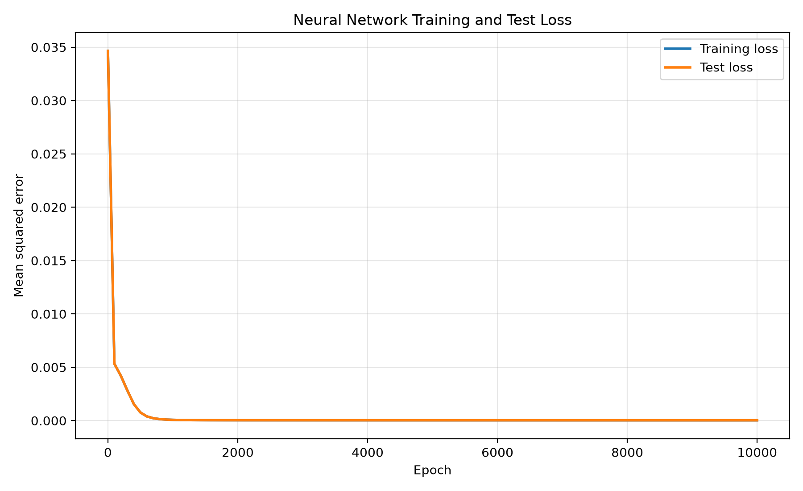
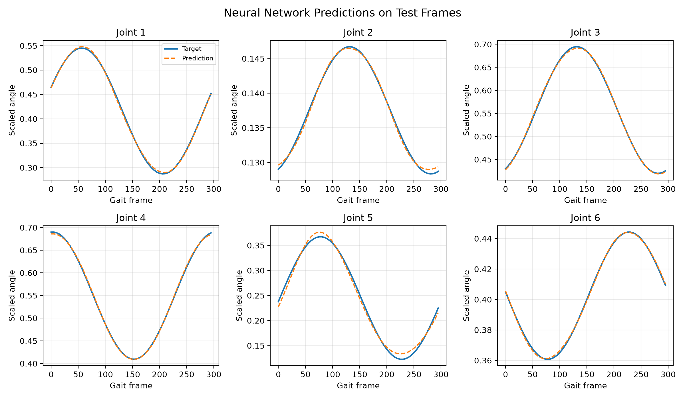
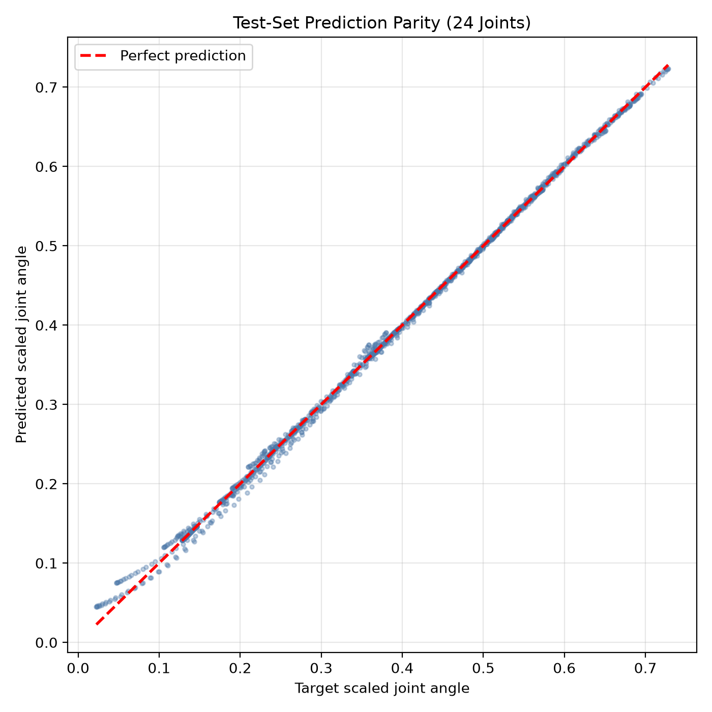
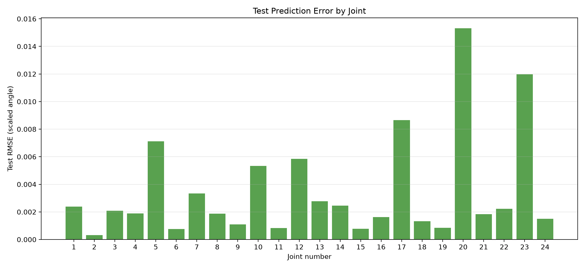

# Part 2 Presentation: Neural-Network Gait Learning

## Slide 1 — Neural-Network Gait Learning

**Presenter:** [Your Name]

**Topic:** Learning the spider gait from phase information

**Key message:** A NumPy-based neural network can reproduce a periodic 24-joint gait with low error.

---

## Slide 2 — Objective

- Learn the relationship between gait phase and joint angles
- Reproduce the 300-frame gait generated by the GA
- Input: sine and cosine of normalized time
- Output: 24 normalized joint angles

**Speaker note:** The goal is supervised learning, not optimization of a gait. The target gait already comes from the genetic algorithm in Part 1.

---

## Slide 3 — Dataset Preparation

- 300 complete gait frames
- 240 training frames
- 60 test frames
- Every fifth frame reserved for testing
- Training output shape: `(240, 24)`
- Test output shape: `(60, 24)`

**Input encoding:**

$$
X = [\sin(2\pi t), \cos(2\pi t)]
$$

**Why this representation:** It encodes periodic motion without separate integer frame indices.

---

## Slide 4 — Network Architecture

- 2 input neurons
- Hidden layer: 32 neurons
- Hidden layer: 32 neurons
- 24 output neurons
- Sigmoid activation
- Learning rate: 0.5
- 10,000 training epochs
- Seed: 42

**Implementation:** Custom NumPy network with forward pass, back propagation, and gradient descent.

---

## Slide 5 — Loss Result

- Initial MSE: approximately 0.034649
- Final training MSE: 0.0000261241
- Final test MSE: 0.0000261241
- Final test RMSE: 0.00511117

**Key interpretation:** Both curves converge nearly together, indicating good generalization and no major overfitting signal.

---

## Slide 6 — Test-Frame Predictions

- Target and predicted trajectories are shown for six representative joints
- Predicted curves follow the periodic target motion closely
- Output range: approximately 0.045 to 0.724 after normalization

**Key interpretation:** The network learned the shape of the gait over a complete cycle rather than memorizing isolated examples.

---

## Slide 7 — Prediction Accuracy

- Each point compares a target joint angle with the network prediction
- Points align along the perfect-prediction diagonal
- Accuracy is consistent across all 24 output joints

**Key interpretation:** The parity plot provides a direct all-joint view of prediction quality.

---

## Slide 8 — Per-Joint Error

- Lowest RMSE: Joint 2, 0.0003246
- Highest RMSE: Joint 20, 0.0153148
- Both values are small in normalized angle units

**Key interpretation:** The network is accurate for every joint, with modestly higher error in one joint motion.

---

## Slide 9 — Validation of the Implementation

- Layer output shape checked: `(5, 24)`
- Sigmoid outputs remain between 0 and 1
- Back propagation matched numerical gradient estimation
- Test learning reduced MSE from 0.0943 to 0.0595 after 2,000 updates
- Trained model was reloaded and reproduced the final test metrics

**Key interpretation:** The implementation and saved model were validated independently.

---

## Slide 10 — Conclusion

- Dataset and network were defined successfully
- The network trained for 10,000 epochs
- Final test MSE: 0.0000261241
- Final test RMSE: 0.00511117
- Loss, prediction, parity, and joint-error graphs confirm accurate gait learning

**Conclusion:** The neural network successfully approximates the spider's periodic 24-joint gait pattern.
