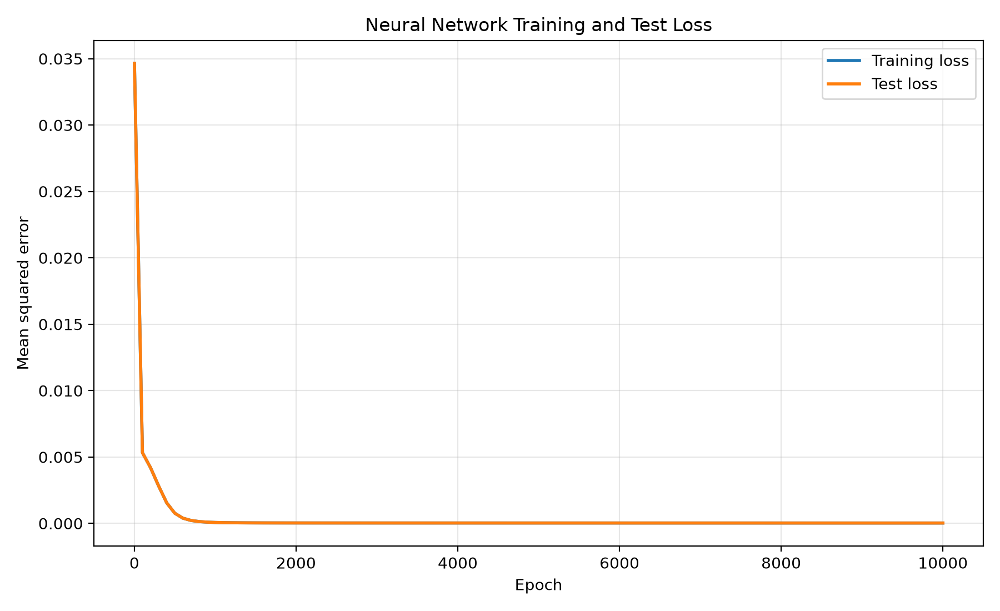
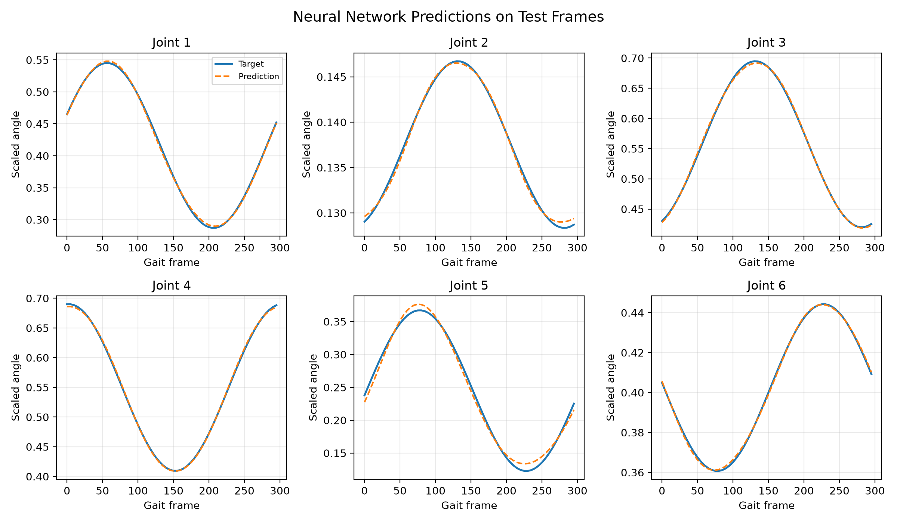
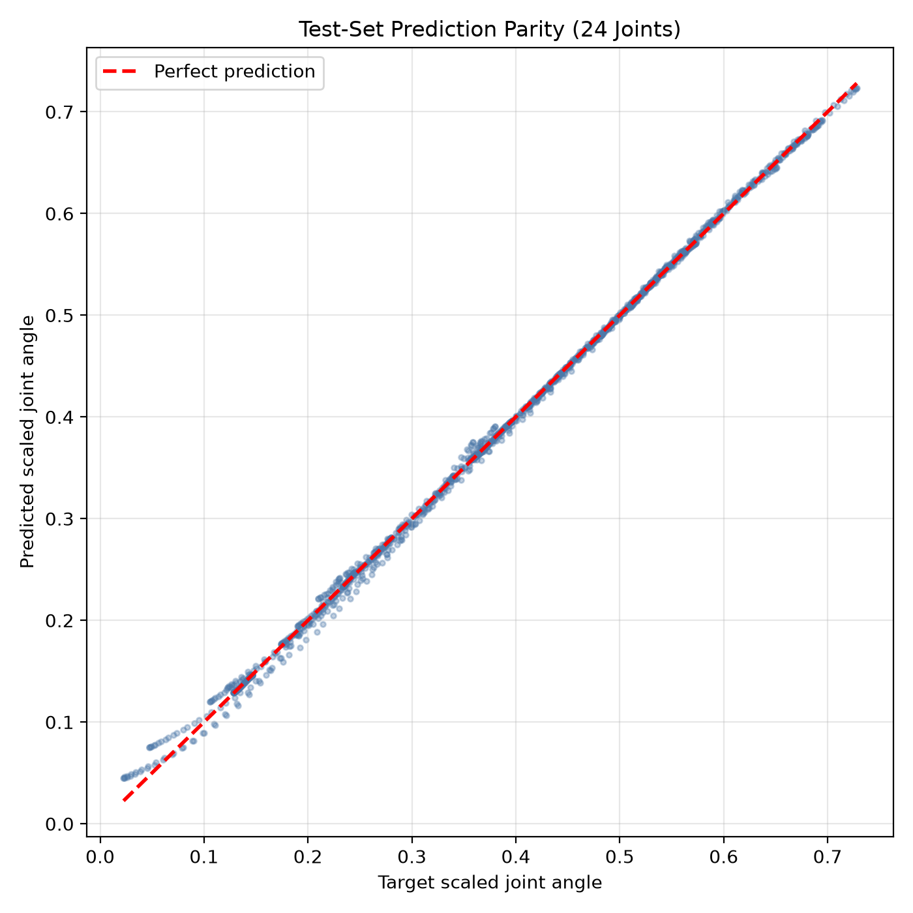
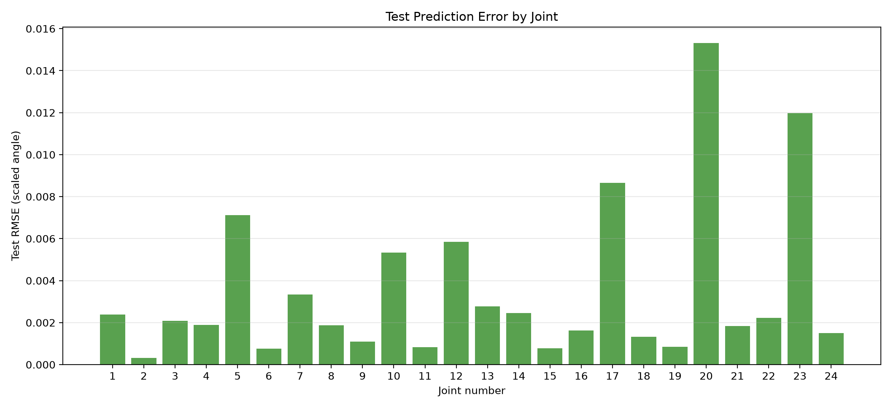

# Part 2: Neural-Network Gait Learning

## 1. Objective

The objective of this section was to train a neural network to approximate the periodic gait generated by the genetic algorithm. The network learns the relationship between a cyclic gait phase and the joint angles required to reproduce the spider's walking motion.

## 2. Dataset

The complete gait contains 300 frames and 24 scaled joint-angle outputs.

- Training set: 240 frames
- Test set: 60 frames
- Test frames: every fifth frame
- Inputs: sine and cosine of the gait phase
- Outputs: 24 normalized joint angles

The input values represent the phase angle using

$$
X = \left[\sin(2\pi t), \cos(2\pi t)\right]
$$

where $t$ is the normalized frame position from 0 to 1. This representation is suitable for periodic motion because sine and cosine naturally encode the start and end of the gait cycle.

The output angles are normalized using the minimum and maximum joint limits:

$$
Y_{scaled} = \frac{Y-Y_{min}}{Y_{max}-Y_{min}}
$$

This keeps all target values in a similar numerical range and allows the sigmoid output layer to represent them directly.

## 3. Network Architecture

A multilayer neural network was implemented from scratch using NumPy, with no PyTorch or TensorFlow dependency.

- Input neurons: 2
- Hidden layers: 32 and 32 neurons
- Output neurons: 24
- Activation function: sigmoid
- Learning rate: 0.5
- Epochs: 10,000
- Random seed: 42

The network was trained using whole-batch back propagation and gradient descent. For every update, the forward pass predicts the joint angles and back propagation adjusts the weights and biases to reduce the mean squared error.

## 4. Training and Test Results

The network training history begins with a training and test MSE of approximately $0.034649$. By epoch 10,000, both errors have converged to approximately $0.00002612$.

| Metric | Training | Test |
|---|---:|---:|
| MSE | 0.0000261241 | 0.0000261241 |
| RMSE | 0.00511117 | 0.00511117 |

The final test RMSE is approximately 0.0051 on the normalized joint-angle scale. This is very small relative to the target joint range of roughly 0.022 to 0.728.

The small difference between training and test loss indicates that the network generalizes well to the held-out frames rather than only fitting the training examples.

## 5. Graph Interpretation

### Training and Test Loss

The loss decreases rapidly during the first part of training and then converges gradually. The training and test curves follow nearly the same trajectory. This supports that the network learned the gait pattern successfully and did not show a large training-test performance gap.

### Test-Frame Predictions

The test prediction graph compares target and predicted values for six representative joint outputs. The predicted curves closely follow the target curves across the gait cycle, demonstrating that the network captures the periodic motion of the joints.

### Prediction Parity

The parity graph plots target values against predicted values across all 24 outputs. The points cluster around the perfect-prediction diagonal. This confirms that low and high normalized joint angles are generally predicted accurately, not just the mean angle.

### Error by Joint

The per-joint test RMSE is low across all 24 outputs. In the final model:

- Lowest-error joint: Joint 2, RMSE 0.0003246
- Highest-error joint: Joint 20, RMSE 0.0153148

Even the highest per-joint RMSE remains small on the normalized scale. The result shows that the network has difficulty with only a single joint's motion to a limited degree and is otherwise consistent across the gait.

## 6. Implementation Validation

The network implementation was checked using three tests:

1. Output shape and output range were verified for 5 examples.
2. Back propagation was compared against numerical gradient estimation for one weight. The analytical gradient was $-0.00087458$, and the numerical gradient was the same to the displayed precision.
3. A learning test showed that MSE decreased from 0.0943 to 0.0595 after 2,000 updates.

The trained model was also reloaded from `trained_model.npz` and used to reproduce the final test metrics. This confirms that the saved model performs consistently with the training run.

## 7. Conclusion

The neural network successfully learned the spider gait from the sine-cosine phase representation. The final test MSE was $2.6124\times10^{-5}$ and the test RMSE was 0.00511 in normalized joint-angle units. The loss curves converge, predictions closely match target gait frames, and parity and per-joint error graphs show consistent accuracy across the 24 output joints.
